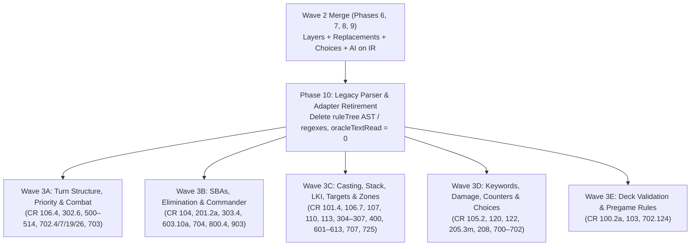

# Exhaustive MTG Comprehensive Rules (`CR 100–905`) Discrepancy Audit & Remediation Plan

This document captures a complete, rule-by-rule audit of [rules.txt](file:///home/ryan/Documents/github/statikana/peckhamr.com/src/lib/rules.txt) (Magic: The Gathering Comprehensive Rules, **CR 100 through CR 905**, 9,459 lines) against the engine implementation in `src/lib/magic/`.

> [!IMPORTANT]
> **Cross-Reference with In-Flight Wave 2 (Phases 6–9):**
> Several rules discrepancies identified in the `engine-rewrite` baseline (`9bf1557`) are already being fixed by the Wave-2 agents currently running in isolated worktrees:
> - **Phase 6 (`runtime/layers.ts`)**: Fixes `CR 107.1b / 208.5` (negative power clamping in layer breakdown), `CR 205.1a / 305.7` (*Song of the Dryads* / `D-Audit-5`), `CR 613.7` (Layer 6 keyword grant/removal timestamp order), `CR 613.8` (*Blood Moon* + *Urborg* dependency), and `"for each"` / `"as long as"` CDAs and P/T modifiers.
> - **Phase 7 (`runtime/replace.ts`)**: Fixes `CR 104.2b` (*Laboratory Maniac* by compiled IR instead of card name), `CR 508.1g` (generic `{N}` attack taxes summed across permanents), `CR 603.2d` (trigger multipliers adding `+1` and respecting cause filters), `CR 614.1a` (counter/token multipliers respecting scope/controller), and IR-driven rule modifiers (`noMaxHandSize`, `cantLose`, `opponentsCantWin`, cast restrictions, `searchControl`, `playerHexproof`, `playerShroud`).
> - **Phase 8 (`runtime/choices.ts`)**: Introduces the unified 6-kind `ChoiceRequest` / `ChoiceAnswer` protocol (`yesNo`, `chooseObjects`, `chooseMode`, `chooseNumber`, `orderObjects`, `chooseReplacement`) and `GameState.engineVersion`, providing the exact infrastructure needed to replace automatic/first-N fallbacks in Legend Rule (`CR 704.5j`), Sacrifice/Discard (`CR 701.8 / 701.19`), Proliferate (`CR 701.31`), and Replacement ordering (`CR 616.1`).
> - **Phase 9 (`ai.ts` — Completed at `6b108d2`)**: Fixes `E3` (`CR 509.1b / 613.1f`) so both bot blocker evaluation and `declare_blockers` evaluate `cantBeBlocked` via Layer 6 abilities (`evaluatePermanent`) rather than raw `oracleText`.

---

## 1. Complete Rule-by-Rule Discrepancy Catalog (`CR 100–905`)

### Section 1: Game Concepts (`CR 100–123`)

| CR Rule | Rule Requirement | Current Engine Behavior & Location | Status / Wave |
| :--- | :--- | :--- | :--- |
| **100.2a / 113.6c** | A deck may contain any number of cards named *Relentless Rats*, etc., unless the card specifies an upper cap (*Seven Dwarves* $\le 7$, *Nazgûl* $\le 9$). | [`MULTI_COPY_CARDS`](file:///home/ryan/Documents/github/statikana/peckhamr.com/src/lib/magic/scryfall.ts#L25-L37) and [`validateDeck`](file:///home/ryan/Documents/github/statikana/peckhamr.com/src/lib/magic/scryfall.ts#L459-L465) allow unlimited copies of `'seven dwarves'` and `'nazgûl'` without enforcing their 7-copy and 9-copy caps. | **Fixed in Wave 3E** |
| **101.2 / 101.2a** | "Can't" effects beat "can" effects, except `"can't have or gain <keyword>"` (`CR 113.10c`) vs `"loses <keyword>"` (`CR 113.11`, which is timestamp-dependent in Layer 6). | [`evaluatePermanent`](file:///home/ryan/Documents/github/statikana/peckhamr.com/src/lib/magic/ruleTree.ts#L2445-L2486) applies `opponentKeywordRemovers` after the Layer 6 timestamp loop, stripping keywords granted with a newer timestamp even when the effect only says `"lose"`. | **Fixed in Phase 6** |
| **101.4 / 121.2c** | When multiple players make choices or take actions simultaneously (e.g. `"Each player draws / sacrifices / discards"`), actions happen in **APNAP order** starting from `activePlayerIndex`. | [`Run.draw`](file:///home/ryan/Documents/github/statikana/peckhamr.com/src/lib/magic/runtime/effects.ts#L440-L443) and legacy multi-player loops in [`engine.ts`](file:///home/ryan/Documents/github/statikana/peckhamr.com/src/lib/magic/engine.ts#L3108-L3415) iterate `state.players` in seat order `0..N-1` regardless of `activePlayerIndex`. | **Wave 3C** |
| **103.1 / 103.2** | Starting player is determined randomly before hands are drawn. | [`createInitialGameState`](file:///home/ryan/Documents/github/statikana/peckhamr.com/src/lib/magic/engine.ts#L323) hardcodes `activePlayerIndex: 0`. | **Wave 3E** |
| **103.5 / 103.5c** | London mulligan: draw 7, then put $N$ cards on bottom of library (`103.5`). Only multiplayer games grant a free first mulligan (`103.5c`). Pregame mulligans do not trigger in-game zone-change abilities. | 1) [`mulligan`](file:///home/ryan/Documents/github/statikana/peckhamr.com/src/lib/magic/engine.ts#L1813) grants a free first mulligan under `london_1free` even in 2-player games. 2) Bot pregame loop in [`createInitialGameState`](file:///home/ryan/Documents/github/statikana/peckhamr.com/src/lib/magic/engine.ts#L349-L355) never increments `mulliganCount` or bottoms cards under `london_standard`. 3) [`mulliganRedraw`](file:///home/ryan/Documents/github/statikana/peckhamr.com/src/lib/magic/runtime/zones.ts#L360-L368) emits live `ZoneChange` events into `state.pendingZoneChanges`. | **Wave 3E** |
| **103.8a / 103.8c** | Starting player skips their Turn 1 draw step in two-player games (`103.8a`), and draws in multiplayer games (`103.8c`). | [`DEFAULT_LOBBY_RULES.firstTurnDraw`](file:///home/ryan/Documents/github/statikana/peckhamr.com/src/lib/magic/types.ts#L159) defaults to `true` regardless of player count, so 2-player games do not skip the Turn 1 draw unless overridden. | **Wave 3E** |
| **104.2a / 104.3h / 104.4a** | If all remaining players lose simultaneously, the game is a draw (`104.4a`). In multiplayer, if the last remaining player is prevented from winning by `"Your opponents can't win the game"` (`104.3h`), the game does not end until that effect ends or they win another way. | In [`checkStateBasedActions`](file:///home/ryan/Documents/github/statikana/peckhamr.com/src/lib/magic/engine.ts#L5049-L5111): 1) `cleanupEliminatedPlayer` runs inside the per-player `for` loop (`5087`), removing that player's *Platinum Emperion* / *Abyssal Persecutor* before later seats' SBAs are checked in the same simultaneous pass. 2) If `remaining.length === 0`, `state.status` remains `'active'` Forever. 3) If `remaining.length === 1` and `playerCannotWinGame` is true (`5094`), all opponents are already `eliminated`, leaving the game permanently stuck with 1 active player. | **Fixed in Wave 3B** |
| **104.3c / 704.5b** | A player who attempted to draw a card from a library with no cards in it **since the last time SBAs were checked** loses the game as a **state-based action** (`704.5b`), not mid-resolution. | [`drawCards`](file:///home/ryan/Documents/github/statikana/peckhamr.com/src/lib/magic/engine.ts#L764-L785) calls `loseTheGame` immediately mid-spell resolution (so a spell that says *"Draw 3 cards, then..."* aborts mid-effect or before replacement/lifegain finishes). | **Fixed in Wave 3B** |
| **105.2 / 202.2 / 708.2a** | An object's color is determined by its mana cost, color indicator, CDAs, and Layer 5 color-changing effects (`setColors`, face-down colorless status). | [`matchesObjectFilter`](file:///home/ryan/Documents/github/statikana/peckhamr.com/src/lib/magic/runtime/objectFilter.ts#L94), [`Run.ForEach`](file:///home/ryan/Documents/github/statikana/peckhamr.com/src/lib/magic/runtime/effects.ts#L508), [`triggers.ts`](file:///home/ryan/Documents/github/statikana/peckhamr.com/src/lib/magic/runtime/triggers.ts#L148), and [`hasProtectionFrom`](file:///home/ryan/Documents/github/statikana/peckhamr.com/src/lib/magic/engine.ts#L5285) read `perm.card.colors` directly, ignoring Layer 5 `setColors` (*Painter's Servant*, *Song of the Dryads* colorless) and `isFaceDown`. | **Fixed in Wave 3D** |
| **106.4 / 500.4 / 703.4p** | Each player's mana pool empties at the **end of each step and phase**. | [`emptyAllPlayersManaPools`](file:///home/ryan/Documents/github/statikana/peckhamr.com/src/lib/magic/engine.ts#L4402-L4406) is only called in `advancePhaseOrStep` (`4413`) and `completeTurnCleanupAndPassTurn` (`4835`). Direct step transitions `upkeep -> draw` (`889`), `draw -> main1` (`826`), `declare_attackers -> declare_blockers/main2` (`1550`), and `main2 -> end_step` (`3975`) never empty mana pools! Also `untap` (`846`) only empties `activePlayer.manaPool`. | **Fixed in Wave 3A** |
| **106.5 / 106.7** | *Exotic Orchard* (`"Add one mana of any color that a land an opponent controls could produce"`) can only produce colors that lands controlled by opponents could produce (`106.7`), and checks Layer 1 copiable values (`perm.copiableCard ?? perm.card`). | 1) [`getPermanentManaProduction`](file:///home/ryan/Documents/github/statikana/peckhamr.com/src/lib/magic/oracle.ts#L164) matches `/\{T\}:\s*Add\s+one\s+mana\s+of\s+any\s+color/i` without an end anchor, so `tap_mana` and auto-tap treat *Exotic Orchard* as *Command Tower* even when opponents control no lands. 2) [`playerLandColors`](file:///home/ryan/Documents/github/statikana/peckhamr.com/src/lib/magic/runtime/effects.ts#L1021) reads `perm.card` instead of `perm.copiableCard ?? perm.card` and skips Layer 4 basic land types (*Urborg* / *Blood Moon*). | **Fixed in Wave 3C** |
| **107.1b / 208.5** | A creature's power or toughness can be negative (e.g. a `1/3` with `-3/-0` has power `-2`, so a `+2/+0` pump brings it to `0`, not `2`); only combat damage assignment/lifegain/counters clamp negative numbers to `0`. | [`getCreaturePower`](file:///home/ryan/Documents/github/statikana/peckhamr.com/src/lib/magic/engine.ts#L406), [`getCreatureToughness`](file:///home/ryan/Documents/github/statikana/peckhamr.com/src/lib/magic/engine.ts#L417), and [`effectivePower`](file:///home/ryan/Documents/github/statikana/peckhamr.com/src/lib/magic/runtime/objectFilter.ts#L42) wrap P/T in `Math.max(0, ...)`. (Layer breakdown fixed in Phase 6; helper callers in `engine.ts` / `objectFilter.ts` still clamp.) | **Fixed in Phase 6 & Wave 3D (`objectFilter.ts`)** |
| **107.3a / 107.3m / 202.3e** | If a spell or ability has `{X}` in its cost, the value of $X$ is chosen on cast/activation (`107.3a`), adds to the spell's mana value on the stack (`202.3e`), and is remembered by the permanent's ETB effects (`107.3m`). | 1) `activate_ability` (`engine.ts:1382, 1405`) has no `xValue` payload (`{X}` in activated costs is ignored). 2) Permanent spell resolution (`engine.ts:2852`) drops `item.xValue`, so ETB triggers see `X = 0`. 3) Stack objects' mana value is read from static `card.cmc` (`X = 0`) instead of `card.cmc + xValue`. | **Fixed in Wave 3C** |
| **107.4e / 107.4f / 107.4h / 202.3f** | Hybrid `{W/U}` can be paid with `{W}` or `{U}` (MV 1); monocolored hybrid `{2/W}` can be paid with `{2}` or `{W}` (MV 2, `202.3f`); Phyrexian `{W/P}` can be paid with `{W}` or 2 life (`107.4f`); Snow `{S}` is paid with mana from a snow source (`107.4h`). | [`parseManaCost`](file:///home/ryan/Documents/github/statikana/peckhamr.com/src/lib/magic/oracle.ts#L57-L68) and [`parseManaString`](file:///home/ryan/Documents/github/statikana/peckhamr.com/src/lib/magic/compiler/costs.ts#L85-L94) treat `{W/U}`, `{2/W}`, and `{W/P}` as strictly requiring the first symbol (`{W}` for `{W/U}`/`{W/P}` and `{2}` generic for `{2/W}`) with no choice to pay the second option or 2 life. | **Fixed in Wave 3C** |
| **108.4a / 400.7** | Only objects on the battlefield or stack have a controller (`108.4`). In any other zone, an object has no controller (defaults to owner `108.4a`). | [`leaveBattlefieldReset`](file:///home/ryan/Documents/github/statikana/peckhamr.com/src/lib/magic/runtime/zones.ts#L178-L190) does not reset `controllerId = ownerId`, and [`effects.ts`](file:///home/ryan/Documents/github/statikana/peckhamr.com/src/lib/magic/runtime/effects.ts#L501) filters non-battlefield zones by `c.controllerId === pid`. | **Fixed in Wave 3C** |
| **110.2a / 110.5b** | Putting a card onto the battlefield puts it under the **effect controller's** control unless specified otherwise (`110.2a`), and permanents enter untapped unless a replacement effect says otherwise (`110.5b`). | 1) [`Run.move`](file:///home/ryan/Documents/github/statikana/peckhamr.com/src/lib/magic/runtime/effects.ts#L869) defaults `toPlayer` to `o.ownerId` instead of `ctx.controllerId` unless `underControl: 'you'` is explicitly set. 2) `cardEntersTapped` is not checked when permanent spells resolve (`engine.ts:2853`) or in `Run.move` (`effects.ts:868`). | **Fixed ETB tapped in Phase 7 / Wave 3D** |
| **111.4 / 111.5** | A token's name is `<Subtype> Token` unless specified (`111.4`). Creating $N$ tokens puts them onto the battlefield simultaneously (`111.5`). | 1) [`createTreasureTokens`](file:///home/ryan/Documents/github/statikana/peckhamr.com/src/lib/magic/engine.ts#L4254) names tokens `'Treasure'` while `effects.ts:751` names them `'Treasure Token'`. 2) [`createTokenOnBoard`](file:///home/ryan/Documents/github/statikana/peckhamr.com/src/lib/magic/engine.ts#L4382) flushes triggers inside the `for (i = 0; i < count; i++)` loop instead of after creating all $N$ tokens. | **Fixed in Wave 3C** |
| **113.6j / 113.7a** | Activated abilities with zone restrictions (`"Activate only if ~ is in your graveyard"`, cycling, unearth) function from that zone (`113.6j`). Once activated/triggered, an ability exists independently of its source and uses **Last Known Information (LKI)** if the source leaves the battlefield (`113.7a`). | 1) [`activate_ability`](file:///home/ryan/Documents/github/statikana/peckhamr.com/src/lib/magic/engine.ts#L1320) only searches `actor.battlefield`. 2) [`sourceCharacteristic`](file:///home/ryan/Documents/github/statikana/peckhamr.com/src/lib/magic/runtime/effects.ts#L315-L325) looks up the live permanent on resolution; if removed in response, it falls back to printed `card.power` (ignoring counters/pumps) or `0` (if it was a token). | **Wave 3D** |
| **116.2f / 116.3 / 118.6 / 118.9d** | Taking a special action (playing a land, suspending a card) requires priority and resets `passedPriorityPlayerIds` (`116.3`/`117.3c`). Cards with no mana cost (`""`) cannot be paid for by normal mana payment from any zone (`118.6`), and Suspend's `"without paying its mana cost"` still applies additional costs/taxes (`118.9d`) and Stax restrictions (`116.2f`). | 1) `play_land` and `suspend_card` do not clear `state.passedPriorityPlayerIds`. 2) [`checkSuspendLegality`](file:///home/ryan/Documents/github/statikana/peckhamr.com/src/lib/magic/engine.ts#L4106) ignores `!globalCheck.ok` (*Rule of Law* / *Drannith Magistrate*) and cost increases (*Thalia*). 3) [`validateAndPriceCast`](file:///home/ryan/Documents/github/statikana/peckhamr.com/src/lib/magic/engine.ts#L6074) only blocks `manaCost === ''` when `fromZone === 'hand'`. | **Fixed in Wave 3C** |
| **120.3 / 122.1c / 122.1d** | Damage prevention shields (`120.3`) and shield counters (`122.1c`) prevent damage/destruction; stun counters (`122.1d`) replace untapping with removing a stun counter whenever a permanent with a stun counter would be untapped (only if it is actually tapped, and including untaps from spells/abilities). | 1) `damagePreventionShield` (`types.ts:582`) is never read when damage is dealt. 2) Shield counters are never checked on damage/destroy. 3) [`untap`](file:///home/ryan/Documents/github/statikana/peckhamr.com/src/lib/magic/engine.ts#L868) removes stun counters even on already-untapped permanents, and spell/ability untaps (`effects.ts:681`) ignore stun counters. 4) [`Run.damage`](file:///home/ryan/Documents/github/statikana/peckhamr.com/src/lib/magic/runtime/effects.ts#L806) with `sel.k === 'all'` increments `damageMarked` on planeswalkers instead of removing `loyalty` counters (`120.3c`). | **Fixed in Wave 3A & Wave 3D (`runtime/effects.ts`)** |

---

### Sections 2–5: Card Parts, Card Types, Zones, and Turn Structure (`CR 200–514`)

| CR Rule | Rule Requirement | Current Engine Behavior & Location | Status / Wave |
| :--- | :--- | :--- | :--- |
| **201.2a / 708.2a** | Face-down permanents have **no name** (`""`), cannot have the same name as any other permanent (`201.2a`), and never die to the Legend Rule. | [`ruleTree.ts`](file:///home/ryan/Documents/github/statikana/peckhamr.com/src/lib/magic/ruleTree.ts#L2540) sets `effectiveName: 'Face-Down Creature'`, while Legend Rule (`engine.ts:4968`) and `matchesObjectFilter` (`objectFilter.ts:86`) read printed `perm.card.name`. | **Fixed in Wave 3B (Legend Rule) / Wave 3D** |
| **201.5 / 201.5c** | When an ability refers to its own card name (`~` or short name), it means **only this specific object** (`instanceId`), not other objects with the same card name. | [`ruleTree.ts`](file:///home/ryan/Documents/github/statikana/peckhamr.com/src/lib/magic/ruleTree.ts#L896) and [`runtime/costs.ts`](file:///home/ryan/Documents/github/statikana/peckhamr.com/src/lib/magic/runtime/costs.ts#L154) check `perm.card.name === source.card.name` or `perm.card.id === source.card.id` on `excludeSelf` ("another creature"), falsely excluding other copies/clones of the same card! | **Fixed in Wave 3C** |
| **205.3m / 702.73a** | Two-word creature type `"Time Lord"` is a single creature subtype (`205.3m`). Changeling (`702.73a`) and `*/*` P/T CDAs (`208.2a`) function in **all zones** (hand, graveyard, library, stack, battlefield). | 1) [`splitTypeLine`](file:///home/ryan/Documents/github/statikana/peckhamr.com/src/lib/magic/ruleTree.ts#L285-L315) splits subtypes on whitespace, turning `"Time Lord"` into `"Time"` and `"Lord"`. 2) [`matchesObjectFilter`](file:///home/ryan/Documents/github/statikana/peckhamr.com/src/lib/magic/runtime/objectFilter.ts#L67-L85) only checks `evaluatePermanent` on the battlefield, so Changeling cards in graveyards/libraries fail subtype searches (`"Search your library for a Dragon/Goblin card"`). | **Fixed in Wave 3D** |
| **208.3** | A noncreature permanent has no power or toughness even if printed on the card (e.g., an uncrewed Vehicle or a creature turned into a noncreature land/artifact). | [`getCreaturePower`](file:///home/ryan/Documents/github/statikana/peckhamr.com/src/lib/magic/engine.ts#L400-L406) and [`getCreatureToughness`](file:///home/ryan/Documents/github/statikana/peckhamr.com/src/lib/magic/engine.ts#L411-L417) use `bd.effectivePower ?? inst.card.power ?? 0`, falling back to printed `card.power` when `effectivePower === null`! | **Fixed in Wave 3D (`objectFilter.ts`)** |
| **302.6 / 506.4b** | A creature cannot attack or activate `{T}` abilities unless it has been **under its controller's control continuously since the beginning of their most recent turn** (`302.6`). Changing control of a permanent removes it from combat (`506.4b`). | 1) [`transferBattlefieldControl`](file:///home/ryan/Documents/github/statikana/peckhamr.com/src/lib/magic/runtime/zones.ts#L316-L343) neither sets `summoningSick = true` nor removes the permanent from `state.combat`! 2) Non-creature permanents entering the battlefield (`engine.ts:2858`) set `summoningSick = false`, so animating a newly played artifact/land lets it attack immediately without Haste. | **Fixed in Wave 3A** |
| **303.4d / 303.4f / 704.5m / 704.5n** | An Aura not attached to anything, or attached to an illegal object/player (e.g. wrong type, gained Protection from the Aura's quality, or opponent's creature for `"Enchant creature you control"`), is put into its owner's graveyard as an SBA (`704.5m`). Equipment attached to a non-creature or illegal creature unattaches (`704.5n`). | [`checkStateBasedActions`](file:///home/ryan/Documents/github/statikana/peckhamr.com/src/lib/magic/engine.ts#L4911-L4937) skips Auras with `!perm.attachedToId` (`4913`), never checks whether the enchanted object still matches the `Enchant <quality>` filter or Protection (`702.16c`), and never unattaches Equipment when a host creature gains Protection (`702.16d`). | **Fixed in Wave 3B** |
| **304.4 / 307.4** | Instants (`304.4`) and Sorceries (`307.4`) cannot enter the battlefield; if an effect would put one onto the battlefield, it remains in its previous zone. | [`moveObject`](file:///home/ryan/Documents/github/statikana/peckhamr.com/src/lib/magic/runtime/zones.ts#L194) allows moving an Instant or Sorcery card into `battlefield`. | **Fixed in Wave 3C** |
| **305.2 / 305.6** | `extraLandPlays` static abilities (*Exploration*, *Azusa*) increase the number of lands a player may play each turn (`305.2`). Only lands with basic land subtypes have intrinsic `{T}: Add` mana abilities (`305.6`). | 1) `StaticDef{k:'rule', rule:'extraLandPlays'}` is compiled in `statics.ts:534` but never added to `maxLandsPerTurn` in [`engine.ts`](file:///home/ryan/Documents/github/statikana/peckhamr.com/src/lib/magic/engine.ts#L1072). 2) [`getPermanentManaProduction`](file:///home/ryan/Documents/github/statikana/peckhamr.com/src/lib/magic/oracle.ts#L198-L204) grants a fallback `{T}: Add` mana ability to **every** Land based on `colorIdentity` even if the land has no mana ability (*Maze of Ith*, *Evolving Wilds*)! | **Fixed in Wave 3C** |
| **306.5b / 209.2** | A planeswalker enters the battlefield with a number of loyalty counters equal to its printed loyalty (`306.5b`, replacement effect), whether cast or put onto the battlefield by an effect. | Loyalty counters are only initialized in [`resolveTopOfStack`](file:///home/ryan/Documents/github/statikana/peckhamr.com/src/lib/magic/engine.ts#L2859). Any planeswalker put onto the battlefield via [`moveObject`](file:///home/ryan/Documents/github/statikana/peckhamr.com/src/lib/magic/runtime/zones.ts#L223) (reanimation, flicker, *Deploy the Gatewatch*) enters with `0` loyalty and immediately dies to SBAs! | **Fixed in Wave 3C** |
| **400.3 / 400.7** | Cards in a hand, graveyard, or library can **only** be placed in their **owner's** zone (`400.3`). When an object changes zones, it becomes a new object (`400.7`) and resets transient battlefield statuses; except a resolving permanent spell (`400.7b`) continues from its stack card. | 1) [`moveObject`](file:///home/ryan/Documents/github/statikana/peckhamr.com/src/lib/magic/runtime/zones.ts#L211-L214) uses `opts.toPlayer ?? owner` for `hand`/`graveyard`/`library`, allowing stolen permanents to be put into their controller's hand/graveyard if `toPlayer` is passed. 2) [`leaveBattlefieldReset`](file:///home/ryan/Documents/github/statikana/peckhamr.com/src/lib/magic/runtime/zones.ts#L178-L190) fails to reset `controllerId`, `usedLoyaltyThisTurn`, `transformed`, `isFaceDown`, `goadedByPlayerIds`, `castViaSuspend`, and `playableFromExileBy`. 3) [`resolveTopOfStack`](file:///home/ryan/Documents/github/statikana/peckhamr.com/src/lib/magic/engine.ts#L2853) calls `createCardInstance`, resetting `objectVersion` to `1` instead of incrementing it. | **Fixed in Wave 3C** |
| **500.2 / 503.1a / 504.2 / 513.1a** | A phase or step in which players receive priority (`upkeep`, `draw`, `main1`, `begin_combat`, `declare_attackers`, `declare_blockers`, `combat_damage`, `end_combat`, `main2`, `end_step`) only ends when the stack is empty **and all players pass priority in succession**. | In [`beginPhase`](file:///home/ryan/Documents/github/statikana/peckhamr.com/src/lib/magic/engine.ts#L817-L890) and [`pass_priority`](file:///home/ryan/Documents/github/statikana/peckhamr.com/src/lib/magic/engine.ts#L3974-L3983): if `state.stack.length === 0` after triggers flush, `upkeep`, `draw`, and `end_step` **immediately auto-advance** without granting priority to any player! | **Fixed in Wave 3A** |
| **506.1 / 507.1 / 511.1 / 511.3** | The Combat Phase consists of 5 steps: `begin_combat` (`507`), `declare_attackers` (`508`), `declare_blockers` (`509`), `combat_damage` (`510`), and `end_combat` (`511`). Permanents remain attacking/blocking until `end_combat` ends (`511.3`). | [`advancePhaseOrStep`](file:///home/ryan/Documents/github/statikana/peckhamr.com/src/lib/magic/engine.ts#L4432-L4475) skips `begin_combat` (`main1 -> declare_attackers`, so *"At the beginning of combat on your turn"* triggers never fire!) and skips `end_combat` (`combat_damage -> main2`, clearing `state.combat` immediately after damage). | **Fixed in Wave 3A** |
| **508.1 / 508.2** | After attackers are declared, the active player receives priority in the `declare_attackers` step (`508.2`) before moving to `declare_blockers`. | [`declare_attackers`](file:///home/ryan/Documents/github/statikana/peckhamr.com/src/lib/magic/engine.ts#L1550-L1556) immediately sets `state.phase = 'declare_blockers'` and gives priority to the defending player, skipping priority in `declare_attackers`! | **Fixed in Wave 3A** |
| **509.1 / 509.1a / 509.1b** | Blockers are declared once as a turn-based action at the start of `declare_blockers` (`509.1`). Each blocker can block **at most one** attacker unless an effect says otherwise (`509.1a`), and must obey `cantBlock` and Protection (`702.16e`). | [`declare_blockers`](file:///home/ryan/Documents/github/statikana/peckhamr.com/src/lib/magic/engine.ts#L1568-L1645): 1) Never checks `state.priorityPlayerId === action.actorId`, `state.stack.length === 0`, or whether blockers were already declared this step. 2) **Never checks for duplicate `blockerInstanceId` in `action.blocks`**, allowing one creature to block every attacker simultaneously! 3) Does not check `hasProtectionFrom(attacker, blocker)` (`702.16e`) or `cantBlock` (`StaticDef{k:'restriction'}`). | **Fixed in Wave 3A** |
| **508.1b / 510.1c / 702.19c** | When attacking a planeswalker, `defenderPlaneswalkerId` must be a planeswalker controlled by the defending player (`508.1b`). If blocked and the attacker has Trample, excess combat damage is assigned to the **planeswalker being attacked** (`702.19c`), not the defending player. | 1) [`declare_attackers`](file:///home/ryan/Documents/github/statikana/peckhamr.com/src/lib/magic/engine.ts#L1449-L1517) never validates that `defenderPlaneswalkerId` exists on `defender.battlefield` or is a Planeswalker. 2) In [`resolveCombatDamagePacket`](file:///home/ryan/Documents/github/statikana/peckhamr.com/src/lib/magic/engine.ts#L4688-L4722), unblocked attackers hit `defWalker` (`4608`), but **blocked Trample attackers deal excess trample damage to `defPlayer` (`4715`) instead of `defWalker`!** | **Fixed in Wave 3A** |
| **514.3 / 514.3a** | Normally no player receives priority during the Cleanup Step (`514.3`). Only if an SBA is performed or a triggered ability triggers during cleanup do players receive priority, followed by another cleanup step (`514.3a`). | [`completeTurnCleanupAndPassTurn`](file:///home/ryan/Documents/github/statikana/peckhamr.com/src/lib/magic/engine.ts#L4819-L4857) clears damage and EOT effects and immediately passes the turn without checking SBAs (e.g. a creature whose toughness drops to lethal after losing a giant growth + damage ordering, or discard triggers like *Waste Not* needing to resolve before the turn ends). | **Fixed in Wave 3A** |

---

### Section 6: Spells, Abilities, and Effects (`CR 600–616`)

| CR Rule | Rule Requirement | Current Engine Behavior & Location | Status / Wave |
| :--- | :--- | :--- | :--- |
| **601.2a–i** | Casting sequence: put spell on stack (`601.2a`), make modal/cost/X/target choices (`601.2b–d`), lock total cost (`601.2f`), pay costs (`601.2h`), then spell becomes cast (`601.2i`). | [`cast_spell`](file:///home/ryan/Documents/github/statikana/peckhamr.com/src/lib/magic/engine.ts#L1229-L1244) pays costs while the card is still in its source zone before moving it to `state.stack`, and legacy modal spells in [`oracle.ts`](file:///home/ryan/Documents/github/statikana/peckhamr.com/src/lib/magic/oracle.ts#L828-L889) execute all bulleted modes simultaneously unless routed through IR `chooseMode`. | **Fixed in Wave 3C** |
| **601.2c / 115.9c** | The number of targets is determined by each instance of the word `"target"`. The same object cannot be chosen multiple times for a single `"target [N]"` phrase, but **can** be chosen for separate `"target"` instances (`115.9c`). | [`extractTargetRequirement`](file:///home/ryan/Documents/github/statikana/peckhamr.com/src/lib/magic/oracle.ts#L502-L597) collapses multi-target clauses into a single filter, and [`validateChosenTargets`](file:///home/ryan/Documents/github/statikana/peckhamr.com/src/lib/magic/engine.ts#L5730) forbids duplicate IDs across the entire `chosenTargetIds` array. | **Fixed in Wave 3C** |
| **601.2f / 118.9d** | Total cost = base mana cost or alternative cost (such as `"without paying its mana cost"` / `setZero`) **plus** cost increases/Commander Tax **minus** cost reductions. | [`computeAdjustedManaCost`](file:///home/ryan/Documents/github/statikana/peckhamr.com/src/lib/magic/runtime/costs.ts#L217) returns a zeroed cost immediately when `hasSetZero` is true, wiping out Commander Tax and cost increases (*Thalia*). | **Fixed in Wave 3C** |
| **602.1a** | An activated ability is always `[Cost]: [Effect]`, regardless of how long the cost text is. | [`parseActivatedAbilities`](file:///home/ryan/Documents/github/statikana/peckhamr.com/src/lib/magic/oracle.ts#L297) rejects any line where `colonIdx > 75`, silently dropping activated abilities with long multi-part costs! | **Fixed in Wave 3C** |
| **603.2 / 603.3 / 603.3b / 603.3d** | Triggered abilities **never** resolve inline during an action or SBA loop; they wait to be put on the stack in **APNAP order** (`603.3b`) right before a player receives priority, choosing targets when put on the stack (`603.3d`). | 1) [`defaultTriggerDelivery`](file:///home/ryan/Documents/github/statikana/peckhamr.com/src/lib/magic/runtime/triggers.ts#L309) defaults all non-`PhaseBegin` triggers (`ZoneChange`, `SpellCast`, `LifeChanged`, `CounterChanged`, `DamageDealt`, `AttackersDeclared`) to `'inline'` immediate resolution unless a stack consumer exists. 2) Simultaneous triggers are queued in player array order instead of APNAP order. 3) Triggered abilities do not prompt the controller to choose targets when placed on the stack (`chosenTargetIds: []`). | **Fixed in Phase 5 / Wave 3D** |
| **603.6c / 603.10a** | Leaves-the-battlefield abilities (including `"Whenever a creature dies"`, `"Whenever a permanent is put into a graveyard"`) **look back in time** to the game state immediately before the simultaneous event (`603.10a`). If *Blood Artist* and 5 other creatures die simultaneously to *Wrath of God* or combat damage, *Blood Artist* triggers for all 6 creatures. | Both [`Run.destroy`](file:///home/ryan/Documents/github/statikana/peckhamr.com/src/lib/magic/runtime/effects.ts#L646-L654) and [`checkStateBasedActions`](file:///home/ryan/Documents/github/statikana/peckhamr.com/src/lib/magic/engine.ts#L4942-L4945) call `moveObject` one permanent at a time in a `for` loop. When Permanent 1 moves to the graveyard, it is already gone from `battlefield` before Permanent 2 moves, so observer dies triggers on Permanent 1 never see Permanents 2..N die! | **Fixed in Wave 3B & Wave 3D** |
| **603.7c** | A delayed triggered ability that refers to a specific object (`"return that card"`, `"sacrifice it at the beginning of the next end step"`) only affects that exact object (`targetObjectVersion`). | [`fireDelayedTriggers`](file:///home/ryan/Documents/github/statikana/peckhamr.com/src/lib/magic/engine.ts#L1028-L1063) stores `targetObjectVersion` on `DelayedTrigger` (`types.ts:624`) but never checks `perm.objectVersion === dt.targetObjectVersion` when firing! | **Fixed in Wave 3C** |
| **608.2b** | On resolution, a spell/ability re-checks whether its targets are **still legal** (same `objectVersion` in expected zone, still satisfies type/subtype/controller/targeting restrictions, and hasn't gained Hexproof/Shroud/Protection). | [`isTargetStillValid`](file:///home/ryan/Documents/github/statikana/peckhamr.com/src/lib/magic/engine.ts#L6247-L6280) only checks that the `instanceId` is still in the zone and not phased out or newly Hexproof/Protected; it **never checks `objectVersion`** (so a flickered creature is still hit!), **never checks controller** (so `Equip` still attaches if the target creature was stolen in response!), and **never re-checks card type/subtype/filter**! | **Fixed in Wave 3C** |
| **608.2c / 608.2n** | Instructions of a resolving spell/ability execute in printed order (`608.2c`), and the spell remains on the stack until **all** of its instructions (including interactive Scry/Search choices) have finished (`608.2n`). | 1) [`resolveTopOfStack`](file:///home/ryan/Documents/github/statikana/peckhamr.com/src/lib/magic/engine.ts#L2598) calls `state.stack.pop()` at the very start of resolution and moves the spell to the graveyard at line `2927` even while `state.pendingPrompt` (e.g. Scry or Search) is still open, and [`effects.ts`](file:///home/ryan/Documents/github/statikana/peckhamr.com/src/lib/magic/runtime/effects.ts#L793-L801) continues executing subsequent steps after opening a human prompt! 2) Legacy `parseOracleEffect` (`oracle.ts:828`) executes effects in fixed category order instead of printed order. | **Fixed in Wave 3C** |
| **611.2b / 611.2c / 613.7e** | 1) `"Until your next turn"` effects last until the controller's next turn begins (`611.2b`). 2) Continuous effects from resolving spells/abilities that modify characteristics (`"Creatures you control get +1/+1 until end of turn"`) **lock in the set of affected objects** at resolution (`611.2c`). 3) Attaching an Aura/Equipment to a different object gives that Aura/Equipment a **new timestamp** (`613.7e`). | 1) [`Run.grantPlayer`](file:///home/ryan/Documents/github/statikana/peckhamr.com/src/lib/magic/runtime/effects.ts#L884) ignores `effect.duration` (`'untilYourNextTurn'` vs `'endOfTurn'`). 2) [`Run. attach`](file:///home/ryan/Documents/github/statikana/peckhamr.com/src/lib/magic/runtime/effects.ts#L691) and legacy Equip (`engine.ts:3218`) mutate `attachedToId` without updating `equipment.timestamp = allocateTimestamp(state)`! | **Fixed in Wave 3C & Wave 3D** |

---

### Sections 7–9: Keywords, Turn-Based Actions, SBAs, Copying, Multiplayer, and Commander (`CR 700–905`)

| CR Rule | Rule Requirement | Current Engine Behavior & Location | Status / Wave |
| :--- | :--- | :--- | :--- |
| **700.5** | Devotion to a color is the number of mana symbols of that color in the mana costs of permanents you control, using Layer 1 copiable values (`copiableCard`, `isFaceDown = 0`) and counting hybrid symbols toward both of their colors (`700.5b`). | [`countDevotion`](file:///home/ryan/Documents/github/statikana/peckhamr.com/src/lib/magic/runtime/effects.ts#L966) reads `perm.card.manaCost` instead of `perm.copiableCard ?? perm.card` and doesn't skip `perm.isFaceDown`. | **Fixed in Wave 3D** |
| **701.3b** | Attempting to attach an Aura/Equipment to an object it is **already attached to** does nothing (`701.3b`). | [`Run.attach`](file:///home/ryan/Documents/github/statikana/peckhamr.com/src/lib/magic/runtime/effects.ts#L690-L699) unconditionally sets `attachedToId` and emits an `Attached` event even when `att.attachedToId === host.instanceId`. | **Fixed in Wave 3D** |
| **701.8 / 701.19 / 701.31** | Effect `discard` (`701.8a`), `sacrifice` (`701.19a`), and `proliferate` (`701.31a`) require the affected player to choose the cards/permanents (unless `atRandom`, which must use `nextRandom(state)`), and Proliferate adds one counter of **each** kind already on any chosen permanents/players. | 1) [`Run.discard`](file:///home/ryan/Documents/github/statikana/peckhamr.com/src/lib/magic/runtime/effects.ts#L911) and [`Run.sacrifice`](file:///home/ryan/Documents/github/statikana/peckhamr.com/src/lib/magic/runtime/effects.ts#L924) silently take `.slice(0, count)` without player choice or PRNG for `atRandom`! 2) [`proliferate`](file:///home/ryan/Documents/github/statikana/peckhamr.com/src/lib/magic/engine.ts#L4386) only affects `controller.battlefield` and only increments `'1/1'`, `'loyalty'`, and `'charge'` counters (ignoring `-1/-1`, `time`, `lore`, `poison`, etc. and opponents' permanents). | **Fixed `discard`/`sacrifice` in Wave 3D** |
| **701.12 (`fight`)** | In a fight (`701.12`), if either creature is no longer on the battlefield or is no longer a creature, neither deals or is dealt damage (`701.12b`); if a creature fights itself, it deals damage to itself equal to twice its power (`701.12c`). | In [`runtime/effects.ts`](file:///home/ryan/Documents/github/statikana/peckhamr.com/src/lib/magic/runtime/effects.ts#L332), `'fight'` is listed in `staticallyInterpretable`, **but is completely missing from `interpretableNow` (`360`) and `executeStep` (`628`)**, causing compiled `fight` effects to silently no-op! | **Fixed in Wave 3D** |
| **701.15b (`goad`)** | Goad forces the creature to attack each combat if able and to attack **a player other than the goader** if able (`701.15b`). | [`declare_attackers`](file:///home/ryan/Documents/github/statikana/peckhamr.com/src/lib/magic/engine.ts#L1458) checks that a goaded creature attacks (`mustAttackCreatureIds`), but never checks `goadedByPlayerIds` to require attacking a player other than the goader when able! | **Fixed in Wave 3A** |
| **701.17 (`mill`)** | Milling moves cards from library to graveyard and is subject to graveyard replacement effects (*Rest in Peace*). | [`executeCostStep`](file:///home/ryan/Documents/github/statikana/peckhamr.com/src/lib/magic/runtime/costs.ts#L729) calls `moveObject` for `mill` costs without `{ graveyardReplacement: true }`. | **Fixed in Wave 3C** |
| **702.2 / 702.15 / 702.16b / 702.80 / 702.90** | Deathtouch (`702.2`), Lifelink (`702.15`), Protection damage prevention (`702.16b`), Wither (`702.80`), and Infect (`702.90`) apply to **all** damage (both combat and non-combat damage from spells/abilities). | [`Run.damage`](file:///home/ryan/Documents/github/statikana/peckhamr.com/src/lib/magic/runtime/effects.ts#L806-L819) and [`resolveStackDamageTarget`](file:///home/ryan/Documents/github/statikana/peckhamr.com/src/lib/magic/engine.ts#L2231-L2277) just add `damageMarked` or subtract `life` without checking source Deathtouch, Lifelink, Infect, Wither, or target Protection! | **Fixed in Wave 3D (`runtime/effects.ts`)** |
| **702.4 / 702.7 / 510.2** | First Strike and Double Strike (`702.4b`/`702.7b`) track per-creature whether a creature assigned combat damage in the first-strike step (`702.7c`), and all combat damage within a step is dealt **simultaneously** (`510.2`, so an Infect attacker does not shrink a blocker's power before the blocker deals damage in the same step). | 1) [`CombatState`](file:///home/ryan/Documents/github/statikana/peckhamr.com/src/lib/magic/types.ts#L455) uses a single global boolean `damageDealtFirstStrike` instead of per-creature tracking. 2) [`resolveCombatDamagePacket`](file:///home/ryan/Documents/github/statikana/peckhamr.com/src/lib/magic/engine.ts#L4624-L4667) applies attacker Infect `-1/-1` counters (`4625`) *before* computing `blkPower = getCreaturePower(state, blk)` (`4663`), shrinking the blocker's damage mid-step! | **Fixed in Wave 3A** |
| **702.6a (`Equip`)** | `"Equip [quality]"` (e.g. *Skullclamp*, *Lightning Greaves*, `"Equip legendary creature"`, `"Equip Knight"`) restricts legal targets to creatures you control matching `[quality]`. | [`parseActivatedAbilities`](file:///home/ryan/Documents/github/statikana/peckhamr.com/src/lib/magic/oracle.ts#L242-L254) matches `/^equip\b/i` and ignores `[quality]`. | **Wave 3D** |
| **702.11d (`Hexproof from`)** | `"Hexproof from [quality]"` only prevents targeting by spells/abilities controlled by opponents that match `[quality]`. | [`ruleTree.ts`](file:///home/ryan/Documents/github/statikana/peckhamr.com/src/lib/magic/ruleTree.ts#L1081) matches `/\bhexproof\b/i`, granting unconditional Hexproof to cards with `"Hexproof from ..."`. | **Fixed in Phase 6 / Wave 3D** |
| **702.21 (`Ward`)** | `"Ward [cost]"` is a triggered ability: whenever this permanent becomes the target of a spell or ability an opponent controls, counter it unless that player pays `[cost]`. | `ward` is recognized in `KNOWN_KEYWORDS` (`compiler/adapter.ts:348`) but never triggers or prompts in `triggers.ts` / `engine.ts`. | **Wave 3D** |
| **702.26a / 702.26g (`Phasing`)** | During the untap step, permanents controlled by the active player with the `Phasing` keyword phase out at the same time that phased-out permanents phase in (`702.26a`), and indirectly phased-out attachments phase in with their host regardless of the attachment's controller (`702.26g`). | [`beginPhase('untap')`](file:///home/ryan/Documents/github/statikana/peckhamr.com/src/lib/magic/engine.ts#L848-L855) only phases in already `phasedOut` permanents on `activePlayer.battlefield` (never phasing out permanents with `Phasing`, and missing cross-controller `phasedOutIndirectly` Auras). | **Fixed in Wave 3A** |
| **702.124 (`Partner`)** | Partner variants (`Partner`, `Partner with [Name]`, `Choose a Background`, `Friends forever`, `Doctor's companion` + `Time Lord Doctor`) only pair within their specific rule (`702.124f–k`). | [`cardHasPartner`](file:///home/ryan/Documents/github/statikana/peckhamr.com/src/lib/magic/scryfall.ts#L184) and [`validateDeck`](file:///home/ryan/Documents/github/statikana/peckhamr.com/src/lib/magic/scryfall.ts#L420) treat `Partner`, `Partner with`, and `Friends forever` as interchangeable and reject `Doctor's companion` paired with a `Time Lord Doctor`. | **Fixed in Wave 3E** |
| **703.3 / 502.1 / 504.1 / 510.1 / 514.1** | Turn-based actions at the beginning of a step (`untap`, `draw`, `combat_damage`, `cleanup`) happen **first**, before any `"At the beginning of [step]"` triggers are put on the stack (`703.3`). | [`beginPhase`](file:///home/ryan/Documents/github/statikana/peckhamr.com/src/lib/magic/engine.ts#L803) fires and flushes `PhaseBegin` triggers at line `803` *before* performing the step's turn-based action (untapping, draw-step draw, combat damage). | **Fixed in Wave 3A** |
| **704.3 / 704.5h–q / 704.8** | SBAs are checked in a loop until none apply, **then** all waiting triggers go on the stack (`704.3`). LKI of dying creatures is evaluated *before* simultaneous `+1/+1` and `-1/-1` counter annihilation (`704.8`). | In [`checkStateBasedActions`](file:///home/ryan/Documents/github/statikana/peckhamr.com/src/lib/magic/engine.ts#L4860-L5112): 1) Counter annihilation (`4897`) mutates counters in-place *before* `evaluatePermanent` / LKI capture (`4910`), violating `704.8`! 2) `deathtouchDamageMarked` is never cleared if the creature survived via Indestructible (`4941`), re-triggering every SBA pass. 3) Planeswalker 0-loyalty check (`4948`) is an `else if` after `if (Creature)`, so Planeswalker Creatures (*Gideon*) with 0 loyalty never die (`704.5i`)! 4) Triggers are flushed **inside** the `do ... while (anyActionTaken)` loop (`4957`) instead of after the SBA loop stabilizes (`704.3`). 5) Legend Rule (`4968`) automatically kills all but `group[0]` without prompting the controller (`704.5j`). | **Fixed in Wave 3B** |
| **704.6d / 903.9a / 903.9b** | 1) Commander in graveyard/exile is an SBA (`903.9a`) checked **only if put into that zone since the last SBA check** (declining once leaves it there). 2) Commander going to hand/library is a **replacement effect** (`903.9b`) for both humans and bots. | 1) [`checkStateBasedActions`](file:///home/ryan/Documents/github/statikana/peckhamr.com/src/lib/magic/engine.ts#L5010) checks every commander in `graveyard`/`exile` without tracking whether the SBA was already declined since it entered that zone, causing an **infinite prompt loop** if a human clicks "Keep in Graveyard/Exile"! 2) [`commanderRedirect`](file:///home/ryan/Documents/github/statikana/peckhamr.com/src/lib/magic/runtime/zones.ts#L182) only redirects hand/library moves when `owner?.isBot` is true. | **Fixed in Wave 3B** |
| **707.2** | Layer 1 copy effects set `copiableCard` while on the battlefield; printed characteristics (`perm.card`) remain the physical card's printed values and are restored when leaving the battlefield. | [`resolveTopOfStack`](file:///home/ryan/Documents/github/statikana/peckhamr.com/src/lib/magic/engine.ts#L2893) overwrites `perm.card = { ...baseCardToCopy }` directly instead of setting `perm.copiableCard`, so a dead *Clone* remains the copied creature in the graveyard/hand! | **Fixed in Wave 3C** |
| **725.1 / 725.1b** | `"End the turn"` exiles every object on the stack (including the resolving spell itself, e.g. *Time Stop*, `725.1b`), checks SBAs, and skips straight to cleanup where no player receives priority. | [`resolveTopOfStack`](file:///home/ryan/Documents/github/statikana/peckhamr.com/src/lib/magic/engine.ts#L2598) pops the spell off `state.stack` before executing its effects, so [`endTheTurnImmediately`](file:///home/ryan/Documents/github/statikana/peckhamr.com/src/lib/magic/engine.ts#L4860) fails to exile the resolving spell (which then gets put into the graveyard at `2927` and overwrites the next player's turn step!). | **Fixed in Wave 3C** |
| **800.4a / 800.4j** | When a player leaves the game (`800.4a`): 1) all objects **owned** by that player in **all** zones leave the game; 2) control-changing effects giving that player control of objects end; 3) any remaining objects on the battlefield/stack controlled by that player (e.g. reanimated or *Bribery* permanents) are **exiled**. If the active player leaves the game, their turn continues to its end before the next player's turn begins (`800.4j`). | [`cleanupEliminatedPlayer`](file:///home/ryan/Documents/github/statikana/peckhamr.com/src/lib/magic/engine.ts#L5114-L5186): 1) Never clears `eliminated.graveyard` or `eliminated.command`. 2) Returns permanents on `eliminated.battlefield` owned by other players to `owner.battlefield` even when they were put onto the battlefield under `eliminated`'s control via reanimation/*Bribery* (instead of exiling them when no control effect exists). 3) Calls `completeTurnCleanupAndPassTurn` immediately when the active player is eliminated (`5098`), skipping remaining steps/effects of the turn. | **Fixed in Wave 3B** |
| **903.4 / 903.8** | A player's commander color identity is fixed at game start from their commander(s) regardless of which zone the commander is currently in (`903.4`). Commander tax is tracked per individual commander (`903.8`). | [`getPlayerCommanderIdentity`](file:///home/ryan/Documents/github/statikana/peckhamr.com/src/lib/magic/engine.ts#L533) and [`commanderColors`](file:///home/ryan/Documents/github/statikana/peckhamr.com/src/lib/magic/runtime/effects.ts#L1011) fail to find the commander if it was tucked into `library` or stolen onto an opponent's `battlefield` (turning off *Command Tower* / *Arcane Signet*!). | **Fixed in Wave 3B** |

---

## 2. Phased Remediation Architecture (Post-Wave 2)

Once the in-flight **Wave 2** branches (**Phases 6, 7, 8, and 9**) finish and merge into `engine-rewrite`, we will execute the remaining architecture cleanup (**Phase 10**) and the **Comprehensive Rules Remediation Waves (Wave 3A–3E)** using isolated git worktrees and parallel subagents.

### Phase 10: Retire Legacy Rule-Tree Parser, Adapter & Regexes (`ENGINE_ARCHITECTURE_PLAN.md` Phase 10)
- **Scope**: `src/lib/magic/ruleTree.ts`, `src/lib/magic/oracle.ts`, `src/lib/magic/compiler/adapter.ts`, `src/lib/magic/architecture-allowances.json`.
- **Deliverables**:
  - Remove legacy regex/clause AST parsing from `ruleTree.ts` and `oracle.ts` now that Phases 3–9 run on compiled IR.
  - Drive `architecture-allowances.json` (`oracleTextRead`, `cardNameComparison`, `legacyParserImport`) down to `0` across runtime files.

### Wave 3A: Turn Structure, Priority, Mana Emptying & Combat (`CR 106.4, 302.6, 500–514, 702.4/7/19/26, 703`)
- **Primary Files**: `src/lib/magic/engine.ts` (phase/step machine & combat resolution), `src/lib/magic/types.ts` (`CombatState`), `src/lib/magic/runtime/zones.ts` (`transferBattlefieldControl`).
- **Fixes**:
  1. **Turn-Based Action Ordering (`CR 703.3`)**: Execute turn-based actions in `untap` (phasing in + phasing out permanents with `Phasing` per `CR 702.26a/g`, then untapping), `draw`, `combat_damage`, and `cleanup` *before* flushing `PhaseBegin` triggers.
  2. **Mana Pool Emptying (`CR 106.4 / 500.4`)**: Call `emptyAllPlayersManaPools(state)` on **every** step and phase transition (including `untap`, `upkeep -> draw`, `draw -> main1`, `declare_attackers -> declare_blockers`, `main2 -> end_step`).
  3. **Full Combat Step Sequence (`CR 506–511`)**: Add `begin_combat` and `end_combat` transitions so beginning/end of combat triggers fire and creatures remain attacking/blocking through `end_combat`; grant active player priority in `declare_attackers` after attackers are declared (`CR 508.2`).
  4. **Blocker Validation & Combat Integrity (`CR 509.1, 701.15b, 702.16e, 702.19c`)**:
     - Validate `priorityPlayerId`, `stack.length === 0`, and single-declaration per step in `declare_blockers`.
     - Reject duplicate `blockerInstanceId` assignments unless the blocker has an explicit multi-block static ability (`CR 509.1a`).
     - Enforce Protection (`CR 702.16e`) and `cantBlock` in `declare_blockers`, and Goad `"player other than goader if able"` in `declare_attackers` (`CR 701.15b`).
     - Validate `defenderPlaneswalkerId` on attack declaration and route blocked Trample excess damage to `defWalker` when attacking a planeswalker (`CR 702.19c`).
  5. **Simultaneous Combat Damage & Per-Creature First Strike (`CR 510.2, 702.7c`)**: Snapshot combat damage assignments before applying Infect `-1/-1` counters, and track `dealtFirstStrikeDamageIds: string[]` per creature on `CombatState`.
  6. **Control Change Combat Removal & Summoning Sickness (`CR 302.6, 506.4b`)**: Set `summoningSick = true` on all entering permanents and on `transferBattlefieldControl`, and remove control-changed permanents from `state.combat`.

### Wave 3B: State-Based Actions, Simultaneous Deaths, Elimination & Commander (`CR 104, 201.2a, 303.4, 603.10a, 704, 800.4, 903`)
- **Primary Files**: `src/lib/magic/engine.ts` (`checkStateBasedActions`, `cleanupEliminatedPlayer`, `drawCards`), `src/lib/magic/runtime/zones.ts`.
- **Fixes**:
  1. **Simultaneous SBA Loop & Trigger Deferral (`CR 704.3, 704.8`)**:
     - Capture LKI (`evaluatePermanent`) of all battlefield permanents *before* `+1/+1` and `-1/-1` counter annihilation (`CR 704.8`).
     - Batch all SBA zone moves in a pass simultaneously so `ZoneChange` / dies triggers see the full pre-batch board state (`CR 603.10a`), and flush triggers **after** the SBA `do ... while` loop stabilizes (`CR 704.3`).
     - Fix `else if` between Creature and Planeswalker SBAs so Planeswalker Creatures with 0 loyalty die (`CR 704.5i`), and clear `deathtouchDamageMarked` after SBA evaluation (`CR 704.5h`).
     - Check unattached Auras and Aura/Equipment host legality + Protection (`CR 303.4d, 702.16c/d, 704.5m/n`).
     - Exclude face-down permanents (`CR 201.2a / 708.2a`) from the Legend Rule and prompt human controllers via `chooseObjects` when multiple same-name legends are controlled (`CR 704.5j`).
  2. **Empty-Library SBA, Draw Games & Elimination (`CR 104.3c, 104.4a, 704.5b, 800.4a/j`)**:
     - Set `attemptedDrawFromEmptyLibrary = true` in `drawCards` and process the loss in `checkStateBasedActions` (`CR 704.5b`).
     - Evaluate all players' loss SBAs simultaneously before running `cleanupEliminatedPlayer`; if all remaining players lose simultaneously, end the game as a draw (`CR 104.4a`).
     - In `cleanupEliminatedPlayer` (`CR 800.4a`), remove all objects owned by the eliminated player from **all** zones (including `graveyard` and `command`), end their control-changing effects, and exile any remaining objects they controlled that lack a previous-controller effect.
  3. **Commander Zone SBA vs Replacement & Color Identity (`CR 704.6d, 903.4, 903.8, 903.9a/b`)**:
     - Track `commanderSbaCheckedVersion` on `CardInstance` so declining the graveyard/exile SBA (`CR 903.9a`) does not re-prompt until the commander changes zones again.
     - Prompt human players via `yesNo` choice on `CR 903.9b` hand/library replacement.
     - Store `commanderColorIdentity` and per-commander tax on `PlayerState` at game initialization so tucking or stealing a commander never breaks *Command Tower* / *Arcane Signet* (`CR 903.4`).

### Wave 3C: Casting, Targeting, Stack Resolution, LKI & Zone Integrity (`CR 101.4, 106.7, 107, 110, 113, 304–307, 400, 601–613, 707, 725`)
- **Primary Files**: `src/lib/magic/engine.ts` (cast/activate/resolve), `src/lib/magic/runtime/effects.ts`, `src/lib/magic/runtime/costs.ts`, `src/lib/magic/runtime/triggers.ts`, `src/lib/magic/runtime/zones.ts`.
- **Fixes**:
  1. **Stack Resolution Lifecycle & `"End the Turn"` (`CR 608.2n, 725.1b`)**: Keep the resolving `StackItem` on `state.stack` (or in a paused resolution frame) until all steps and interactive prompts (`scry`, `search`, `chooseObjects`, `yesNo`) complete, and make `endTheTurnImmediately` exile the resolving spell along with the rest of the stack.
  2. **Target Re-validation (`CR 608.2b`)**: In `isTargetStillValid`, verify `target.objectVersion === stackItem.targetObjectVersions[idx]`, re-verify target filter (`matchesObjectFilter`) and controller (e.g. `Equip` requires `"creature you control"`), and fizzle only when all targets are illegal.
  3. **Last Known Information (LKI) & `excludeSelf` (`CR 113.7a, 201.5, 603.10a`)**:
     - Snapshot `sourceLki` (evaluated P/T, colors, types, subtypes, keywords, controller) onto `StackItem` and `PendingTrigger` when created, and use `sourceLki` in `sourceCharacteristic` if the source has left the battlefield.
     - Fix `excludeSelf` in `ruleTree.ts` and `runtime/costs.ts` to compare `perm.instanceId === source.instanceId` only (never `card.name` or `card.id`).
     - Enforce `perm.objectVersion === dt.targetObjectVersion` on `DelayedTrigger` (`CR 603.7c`).
  4. **Zone-Change Rules & Clone Copiable Values (`CR 108.4a, 110.2a, 304.4, 306.5b, 307.4, 400.3, 400.7, 707.2`)**:
     - Force `hand`/`graveyard`/`library` destination to `card.ownerId` (`CR 400.3`), block Instants/Sorceries from entering `battlefield` (`CR 304.4/307.4`), initialize Planeswalker loyalty counters on all battlefield entries (`CR 306.5b`), default `Run.move` to `battlefield` controller to `ctx.controllerId` (`CR 110.2a`), and reset all transient battlefield fields in `leaveBattlefieldReset`.
     - Make *Clone* set `perm.copiableCard` instead of mutating `perm.card` (`CR 707.2`).
     - Update `attachedToId` changes (`Run.attach` / `Equip`) to allocate a new timestamp on the Aura/Equipment (`CR 613.7e`).
  5. **Cost Calculation, `{X}`, Hybrid/Phyrexian Mana & APNAP Loops (`CR 101.4, 107.3, 107.4e/f, 601.2f`)**:
     - Apply cost increases and Commander Tax *after* `setZero` alternative costs (`CR 601.2f`).
     - Propagate `xValue` to resolving permanents (`enteredWithX`) and stack CMC (`CR 202.3e`), and support hybrid/2-brid/Phyrexian mana payment options.
     - Iterate multi-player simultaneous effects and trigger queuing in APNAP order starting from `state.activePlayerIndex` (`CR 101.4 / 603.3b`).

### Wave 3D: Keywords, Non-Combat Damage, Counters & Interactive Effects (`CR 105.2, 120, 122, 205.3m, 208, 700–702`)
- **Primary Files**: `src/lib/magic/runtime/effects.ts`, `src/lib/magic/runtime/objectFilter.ts`, `src/lib/magic/runtime/triggers.ts`, `src/lib/magic/engine.ts`.
- **Fixes**:
  1. **Unified Damage Pipeline (`CR 120.3, 702.2, 702.15, 702.16b, 702.80, 702.90`)**: Route `Run.damage` and stack damage through a single damage helper that checks Protection (`702.16b`), `damagePreventionShield` (`120.3`), Shield counters (`122.1c`), Planeswalker loyalty removal (`120.3c`), Infect/Wither (`-1/-1` and `poison` counters), Deathtouch (`deathtouchDamageMarked`), and Lifelink (`702.15`).
  2. **Missing Keyword Actions & Abilities (`CR 701.8, 701.12, 701.19, 701.31, 702.6a, 702.21, 702.73a`)**:
     - Implement `fight` in `interpretableNow` and `executeStep` in `runtime/effects.ts` (`CR 701.12b/c`).
     - Use `nextRandom(state)` for `discard` / `sacrifice` with `atRandom: true`, and prompt human players via Phase 8's `chooseObjects` for non-random `discard`, `sacrifice`, and `proliferate` (adding 1 of **each** counter kind already on chosen permanents/players per `CR 701.31a`).
     - Trigger `Ward [cost]` (`CR 702.21a`) when a permanent becomes the target of an opponent's spell or ability.
     - Enforce `Equip [quality]` target filters (`CR 702.6a`), stun counter replacement on all untap events (`CR 122.1d`), and all-zone Changeling / `*/*` CDA evaluation in `matchesObjectFilter` (`CR 208.2a, 702.73a`).
     - Use Layer 5 evaluated colors (`evaluatePermanent(state, perm).colors`) in `matchesObjectFilter`, `hasProtectionFrom`, and `triggers.ts`, and preserve multi-word subtype `"Time Lord"` (`CR 205.3m`).

### Wave 3E: Deck Validation & Pregame Rules (`CR 100.2a, 103, 702.124`)
- **Primary Files**: `src/lib/magic/scryfall.ts`, `src/lib/magic/engine.ts` (`createInitialGameState`, `mulligan`).
- **Fixes**:
  - Enforce copy caps on `'seven dwarves'` ($\le 7$) and `'nazgûl'` ($\le 9$) (`CR 100.2a / 113.6c`).
  - Validate specific Partner variant pairings (`Partner`, `Partner with [Name]`, `Choose a Background`, `Friends forever`, `Doctor's companion` + `Time Lord Doctor`) in `scryfall.ts` (`CR 702.124`).
  - Suppress `ZoneChange` trigger emission during pregame `mulliganRedraw`, enforce 2-player Turn 1 draw skip by default (`CR 103.8a`), and only grant free first mulligan in multiplayer (`CR 103.5c`) unless explicitly configured.

---

## 3. Resolved Design Decisions

1. **Empty-Step Priority Stops (`CR 500.2`)**:
   - **Decision**: Wait for manual priority passes in `upkeep`, `draw`, `begin_combat`, `declare_attackers`, `end_combat`, and `end_step` strictly per `CR 500.2` (bots will continue to pass automatically via `runAutomatedPriorityAndBots`, and an auto-pass UI toggle can be added later).
2. **Triggered Ability Stack Delivery (`CR 603.3 / 603.3b`)**:
   - **Decision**: Queue all triggered abilities in **APNAP order** (`CR 603.3b`) after the SBA loop stabilizes (`CR 704.3`), prompt for any required target choices (`CR 603.3d`), and place them on `state.stack` as `triggered_ability` stack items so players can respond in priority order.
